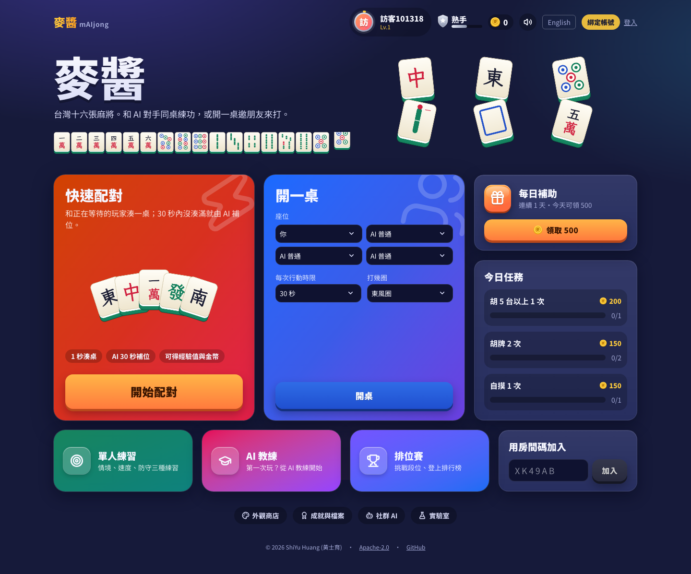
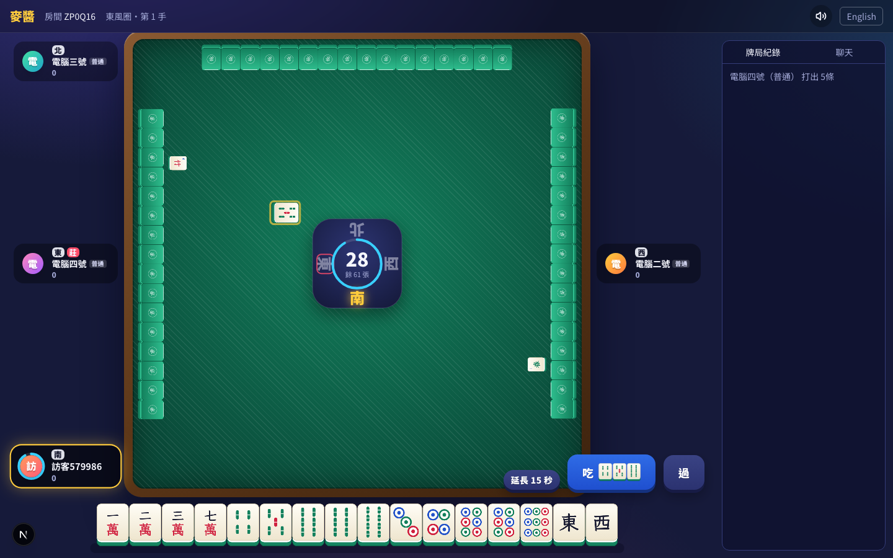
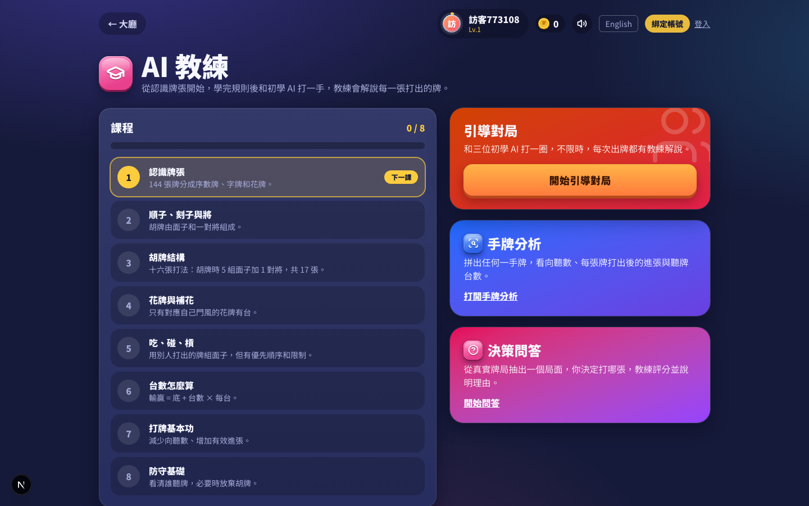
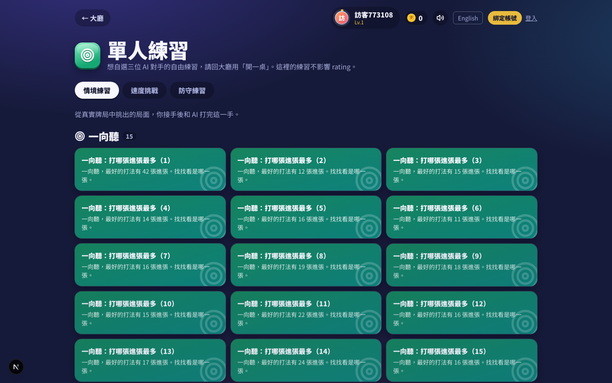
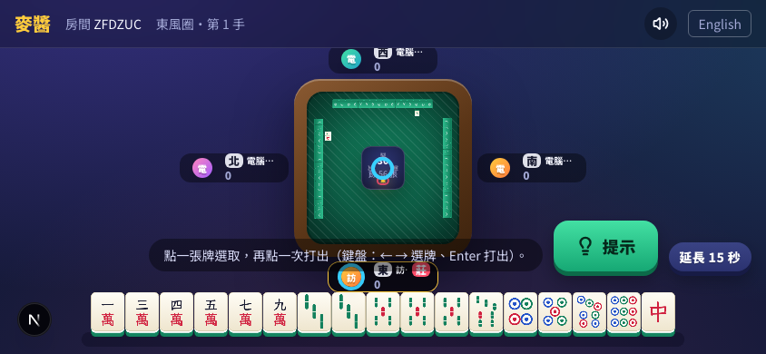
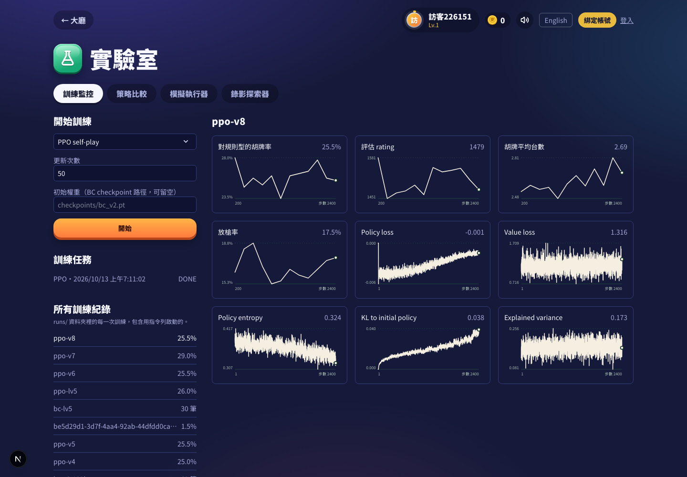

  

<h1 align="center">mAIjong 麥醬</h1>

  <strong>台灣十六張麻將的線上遊戲、AI 練習場與強化學習研究平台。</strong>

  
  
  
  
  
  

  <a href="#快速開始">快速開始</a> ·
  <a href="#遊戲與產品">遊戲功能</a> ·
  <a href="#ai-與強化學習">AI 與 RL</a> ·
  <a href="#開發自己的代理程式">Agent SDK</a> ·
  <a href="#部署設定與測試">部署與開發</a>

和朋友開桌、與不同難度的 AI 對戰，從每一次出牌學習；也可以用同一套規則引擎訓練代理程式、重播牌局，並在固定牌譜上比較策略。介面以繁體中文為主，提供英文切換。

> [!NOTE]
> 本專案實作的是**台灣十六張**玩法。台數與特殊規則依程式內的計分設定；不同地區的麻將慣例可能不同。

## 目錄

- [遊戲與產品](#遊戲與產品)
- [操作與裝置支援](#操作與裝置支援)
- [快速開始](#快速開始)
- [規則與系統架構](#規則與系統架構)
- [即時連線與資料流](#即時連線與資料流)
- [AI 與強化學習](#ai-與強化學習)
- [實驗與模型評估](#實驗與模型評估)
- [開發自己的代理程式](#開發自己的代理程式)
- [部署、設定與測試](#部署設定與測試)
- [授權與貢獻](#授權與貢獻)

## 遊戲與產品

### 從開桌到複盤

1. **開始遊戲**：在大廳快速配對，或建立私人房間、分享房間碼；空位可由 AI 補上。房間可設定回合數、每步時間與各座位的 AI 難度。
2. **看懂牌局**：PixiJS 牌桌呈現四人座位、牌河、牌牆與即時動作。WebSocket 同步吃、碰、槓、聽、胡等決策；斷線時可由電腦暫代，回來後接手。
3. **學習決策**：局內提示顯示向聽、有效進張、聽牌與危險牌；AI 教練提供課程、手牌分析、決策問答與引導對局。解說預設採本機模板，亦可設定相容的 LLM 服務。
4. **回顧與挑戰**：錄影與註解供複盤；情境練習、速度挑戰、防守練習，以及排行、賽季與社群 AI 競技場提供不同目標。玩家檔案記錄等級、任務與外觀；網站也提供 PWA 安裝、鍵盤操作與螢幕閱讀器提示。

| 區域 | 能做什麼 |
| --- | --- |
| [大廳](frontend/app/page.tsx) | 快速配對、建立或加入房間、選擇 AI 與局數 |
| [AI 教練](frontend/app/tutor/page.tsx) | 8 堂課、引導對局、手牌分析與決策問答 |
| [單人練習](frontend/app/practice/page.tsx) | 55 個情境、速度挑戰與防守練習 |
| [實驗室](frontend/app/lab/page.tsx) | 啟動訓練、查看曲線、策略比較、模擬與錄影探索 |
| [社群 AI](frontend/app/agents/page.tsx) | 上傳代理程式、檢視驗證與競技成績 |
| [排行榜](frontend/app/leaderboard/page.tsx) | 賽季、挑戰與人類／AI 排位 |

### 遊戲規則的實作範圍

`engine/` 以一手牌為狀態機，處理發牌、補花、摸打、吃碰槓、宣告聽牌、過水、搶槓、胡牌與流局；`engine/score.py` 定義 39 個台型識別項目（`T00`–`T38`）與支付計算。預設計分為底 100 點、每台 50 點，可透過 `ScoringRules` 調整。規則包含莊家與連莊拉莊、花牌、海底及特殊胡牌時機。

引擎的核心介面 `apply_action(state, player, action)` 回傳新狀態與事件，不改動輸入狀態。固定亂數種子配合動作序列可以重播同一手，讓網站、訓練與驗證共用規則。向聽計算使用預先產生的查表資料（`engine/data/`）。

## 操作與裝置支援

桌面牌桌將四家資訊置於桌框外的四邊中央，保留牌河、手牌、副露與花牌的顯示空間。輪到玩家行動時，資訊區塊與倒數會標示目前狀態；吃、碰、槓、聽與補花以短暫的牌面標記呈現。

手機對局以**橫向遊玩**為主要操作方式。窄螢幕直向進入對局會顯示旋轉提示，轉成橫向後自動顯示牌桌；大廳、課程與排行榜仍可直向瀏覽。這是依螢幕方向顯示的介面提示，瀏覽器不會強制旋轉作業系統畫面。矮螢幕會使用精簡玩家資訊與縮整的操作鈕。

| 操作 | 鍵盤 |
| --- | --- |
| 選擇手牌 | `←`／`→` |
| 打出選牌 | `Enter` |
| 打出並宣告聽牌 | `T` |
| 胡／碰／槓／吃 | `H`／`P`／`K`／`C` |
| 過 | `X` |
| 提示 | `?` |

可操作動作以伺服器回傳的合法動作為準。牌桌另有可供螢幕閱讀器使用的手牌清單與狀態宣告；設定減少動態效果的裝置會停用大部分動畫。PWA 提供安裝與離線頁面，實際多人對局仍需要連線至後端。

## 快速開始

### 需求

- Python **3.12+**；建議使用 [uv](https://docs.astral.sh/uv/)
- Node.js **20+** 與 pnpm
- 本機開發可使用 SQLite，無須先啟動 PostgreSQL、Redis 或 S3

在專案根目錄執行：

~~~bash
uv sync --extra backend --extra ai
(cd frontend && pnpm install)
./scripts/dev.sh
~~~

開啟 [http://localhost:3000](http://localhost:3000)。後端在 [http://localhost:8000](http://localhost:8000)，健康檢查為 `/healthz`，互動 API 文件為 `/docs`。`scripts/dev.sh` 會啟動兩個服務；若只在本機瀏覽，可設定 `DEV_HOST=127.0.0.1`。

想先用終端機體驗規則引擎：

~~~bash
uv run python -m engine.cli play --seed 1
uv run python -m engine.cli watch --seed 3
~~~

只需後端與遊戲功能時，可安裝 `uv sync --extra backend`；訓練與模型推論需要 `ai` 額外套件。更多環境變數參考 [`.env.example`](.env.example)。

### 分別啟動服務

需要調整埠號、除錯 WebSocket 或開啟多個終端機時，可以分別啟動：

~~~bash
# 終端機一：專案根目錄
uv run --no-sync uvicorn backend.main:app --reload --host 127.0.0.1 --port 8000

# 終端機二
cd frontend
pnpm dev
~~~

後端設定由程序環境變數讀取；`.env.example` 是設定參考。若另存為 `.env`，可使用 `uvicorn --env-file .env` 載入後端環境；前端的公開設定可放在 `frontend/.env.local`。`NEXT_PUBLIC_*` 會進入瀏覽器端程式，應僅放公開連線設定。

### 模型與實驗資料

`data/`、`checkpoints/`、`runs/` 都是本機產物目錄，預設不納入 Git。乾淨 clone 不會自動取得本機訓練權重、天梯原始牌譜或歷史訓練曲線。可先以內建規則代理遊玩，再依後文自行產生資料、訓練與評估。

| 路徑 | 內容 | 產生方式 |
| --- | --- | --- |
| `data/bc/` | BC 用對局紀錄 | `scripts/simulate_batch.py --save` |
| `checkpoints/` | PyTorch／SB3 權重與晉升設定 | 各 trainer 與 `ai.training.promote` |
| `runs/<run>/config.json` | 該次訓練參數 | `MetricsLogger` |
| `runs/<run>/metrics.jsonl` | 隨訓練追加的指標 | 各 trainer |
| `data/replays/` | 本機錄影 | 後端對局持久化 |
| `data/agents/` | 社群提交與模型 | 後端提交 API |

## 規則與系統架構

~~~mermaid
flowchart LR
    P["玩家瀏覽器 Next.js / React / PixiJS"] <-->|"HTTP API / WebSocket"| B["FastAPI 房間、教學、競技場、實驗室"]
    B --> E["純 Python 規則引擎 局面、合法動作、台數與支付"]
    B --> A["AI 代理程式 規則／搜尋／神經網路"]
    A --> E
    T["訓練與評估 Gymnasium / PettingZoo"] --> E
    T --> A
    B --> DB[("SQLite / PostgreSQL")]
    B -. "選用" .-> R[("Redis")]
    B -. "選用" .-> S[("S3 相容儲存")]
    SDK["maijong-sdk"] --> E
    SDK --> B
~~~

| 目錄 | 職責 |
| --- | --- |
| `engine/` | 零執行期依賴的台灣十六張規則、向聽、台數與一手／整場狀態 |
| `ai/` | 特徵、代理程式、RL 環境、模型、訓練、自我對弈與評估 |
| `backend/` | FastAPI、WebSocket 房間、SQLAlchemy／Alembic、提示、錄影與競技場 |
| `frontend/` | Next.js 15、React 19、PixiJS 8、Zustand、Tailwind CSS 4 |
| `sdk/`、`packages/` | 對外代理程式 SDK 與可獨立安裝的規則引擎套件 |
| `scripts/`、`tests/` | 模擬與資料產生工具；引擎、AI、後端、SDK 與端對端測試 |

後端預設可使用 SQLite、程序內任務執行器與本機錄影儲存。需要跨實例房間恢復與發布訂閱時可接 Redis；持久化錄影可接 S3 相容儲存；實驗室背景工作可接 Celery。這些服務的設定入口集中在 [`.env.example`](.env.example) 與 [`docker-compose.yml`](docker-compose.yml)。

### 規則引擎的邊界

`GameState` 表達一手的手牌、副露、牌河、牌牆、莊家、圈風、行動階段與支付結果；`Match` 負責跨手的局數、分數與莊家推進。`get_legal_actions` 決定目前座位可採取的動作，`acting_players` 表達當下需要回應的座位。

~~~mermaid
stateDiagram-v2
    [*] --> DISCARD: 發牌與補花
    DISCARD --> RESPONSE: 打出一張牌
    RESPONSE --> DISCARD: 無人取牌或完成吃碰槓
    DISCARD --> ROB_KONG: 加槓的搶槓視窗
    ROB_KONG --> DISCARD: 無人搶槓
    RESPONSE --> ENDED: 胡牌
    ROB_KONG --> ENDED: 搶槓胡
    DISCARD --> ENDED: 自摸或流局
    ENDED --> [*]
~~~

這張圖是主要階段的概覽；補花與槓後補牌等細節由引擎在決策之間推進。計分先選擇胡牌拆解與台型，再依各支付者和莊家的關係結算；完整判定以 [game.py](engine/game.py)、[score.py](engine/score.py) 與 `tests/engine/` 為準。

## 即時連線與資料流

HTTP API 處理帳號、房間建立、練習、歷史資料與實驗室任務；WebSocket 處理牌局狀態與行動。後端持有權威局面，前端送出動作後仍由引擎驗證，不以畫面上的按鈕作為規則判定依據。

~~~mermaid
sequenceDiagram
    participant C as 瀏覽器
    participant API as FastAPI
    participant R as Room
    participant E as 規則引擎
    C->>API: POST /api/v1/rooms
    C->>API: POST /api/v1/rooms/{id}/join
    API-->>C: 座位與 WebSocket token
    C->>API: WS /ws/game/{id}?token=...
    API->>R: 連線與同步
    R-->>C: JOINED / ROOM_STATE
    C->>API: POST /api/v1/rooms/{id}/start
    R->>E: 建立一手牌
    R-->>C: STATE_UPDATE / ACTION_REQUEST
    C->>R: ACTION
    R->>E: apply_action
    E-->>R: 新局面與事件
    R-->>C: PLAYER_ACTION / STATE_UPDATE
~~~

[Room](backend/ws/hub.py) 管理座位、行動鎖、計時器、AI 任務與下一手流程。傳給玩家的局面經 [view.py](backend/ws/view.py) 遮蔽其他人的暗牌；觀戰也有獨立的公開視角。斷線會經過寬限期才由 AI 接管，重連是否收回控制權依後端重連視窗判斷。

`batch=1` 啟用 WebSocket 批次訊息：同一波事件封裝成 `BATCH`，批次內只保留最後一份完整 `STATE_UPDATE`，其餘動作事件仍依序傳送。前端拆開批次後更新 Zustand；PixiJS 使用 sprite pool 重用牌張物件，DOM 層負責玩家資訊、操作鈕與無障礙內容，兩者共用 `tableLayout` 幾何資料。

### API 導覽

預設前綴是 `/api/v1`；完整 request／response schema 可在啟動後開啟 `/docs`。

| 路由區域 | 用途 |
| --- | --- |
| `/auth`、`/profile`、`/shop` | 訪客與會員、個人進度、任務、外觀 |
| `/rooms` | 建桌、配對、加入與開局 |
| `/games/{id}` | 對局資料、重播、影格、下載與註解 |
| `/tutor`、`/practice` | 課程、分析、問答與練習 |
| `/lab` | 模擬、策略比較、訓練任務與 run 指標 |
| `/agents` | 社群代理提交、驗證與資料 |
| `/leaderboard`、`/seasons`、`/challenges` | 排行、賽季與挑戰 |
| `/healthz`、`/metrics` | 健康檢查與監控，無 API 前綴 |

## AI 與強化學習

mAIjong 將**遊戲中的 AI 難度**與**研究用模型**分開管理。玩家看到的 Lv1 是隨機代理，Lv2–3 是不同溫度的規則代理；Lv4 可載入 DQN checkpoint，否則退回規則代理。Lv5 優先讀取 `checkpoints/level5.json` 的晉升紀錄，也可載入已選出的神經網路模型；本機歷史實驗的晉升紀錄指向 **CEM 調參的規則代理**（`checkpoints/rule_cem_v1.json`）；PPO 等模型在此仍屬研究候選。詳見 [代理工廠](ai/agents/__init__.py) 與本機 `checkpoints/level5.json`。

### RL 問題定義

| 項目 | 單一學習座位 `MahjongEnv` |
| --- | --- |
| Episode | 一手牌；其餘三席由指定代理程式行動 |
| Observation | `tiles`：34 種牌 × 14 個通道；`scalars`：13 個局面數值 |
| Action | `Discrete(108)`，包含打牌與吃碰槓聽胡等編碼 |
| 合法性 | `info["legal_mask"]`／`action_masks()`，只在可行動作中選擇 |
| Reward | 依向聽、有效進張、花牌及終局結果計算；訓練預設採 `potential` preset |

`ai/env.py` 提供 Gymnasium API；`ai/marl/pettingzoo_env.py` 則提供四席皆可由代理控制的 PettingZoo AEC 環境，終局依各席支付分數給獎勵。編碼與合法動作遮罩和公開 SDK 共用，方便同一代理在訓練與提交時使用一致輸入。`potential` preset 以牌型品質的前後差與實際支付點數為主，避免只獎勵「進步」而讓策略重複拆牌刷分；`spec` preset 保留原始台數導向設計。細節見 [reward 實作](ai/reward.py)。

~~~mermaid
flowchart LR
    E["規則引擎 新局與合法動作"] --> O["觀測編碼 34×14 + 13"]
    O --> M["合法動作遮罩 108 actions"]
    M --> P["策略／價值網路"]
    P --> D["選擇動作"]
    D --> E
    E --> W["終局支付與 shaping reward"]
    W --> U["PPO / DQN 更新"]
    U --> P
    P --> C["Checkpoint"]
    C --> V["同牌譜配對評估 座位輪替"]
    V --> G["晉升為遊戲代理"]
~~~

### 觀測特徵與資訊限制

[SDK 特徵編碼](sdk/maijong_sdk/features.py) 將觀測轉為 `float32`。34 種牌只含一般牌，花牌資訊由 scalar 與觀測結構表示；對手暗牌不會出現在 SDK 觀測中。

| `tiles` 通道 | 內容 |
| --- | --- |
| 0 | 自己手牌的各牌種數量 |
| 1 | 自己副露出現的牌種 |
| 2 | 自己牌河出現的牌種 |
| 3–5 | 其餘三席牌河，按相對座位排列 |
| 6–8 | 其餘三席公開副露 |
| 9 | 剩餘可摸張數／64，廣播至各牌種 |
| 10 | 尚未在牌河出現的牌種 |
| 11 | 有效進張牌種 |
| 12–13 | 自己門風與圈風 |

13 個 scalar 包含連莊、自己與三名對手分數、總棄牌量、自己花牌台數、是否莊家、向聽，以及四席宣告聽牌旗標。分數除以 1000、向聽除以 8 等縮放方式固定於編碼器，修改特徵時應連同模型與 SDK 相容性一起考量。

伺服器內部 `Agent.act` 為方便引擎整合會取得完整狀態，代理作者仍應遵守可見資訊限制；對外 `BaseAgent.decide` 接收遮蔽後的 `Observation`。神經網路編碼經 SDK 的 `observe`，避免直接把完整狀態輸入模型。

### 108 個動作如何編碼

| ID | 動作 |
| --- | --- |
| 0–33 | 打出指定牌種 |
| 34–67 | 對指定牌種執行槓；實際槓類型依局面判斷 |
| 68 | 碰 |
| 69–71 | 三種吃牌組合 |
| 72 | 胡 |
| 73 | 過 |
| 74–107 | 打出指定牌種並宣告聽牌 |

動作編碼來自 [actions.py](engine/actions.py)。合法遮罩與模型分布必須一起使用：MaskablePPO 透過 `action_masks()` 取得遮罩，自寫策略在輸出分布排除非法動作。Gymnasium 環境對未遮罩的非法採樣會替換為合法動作並給懲罰；公開 SDK 驗證則會將代理回傳非法動作視為失敗。

### 網路結構與學習設計

共用 `MahjongEncoder` 預設使用三層 1D CNN（通道 64 → 128 → 128），沿 34 種牌抽取特徵後投影成 256 維 latent，再與 13 個 scalar 融合。程式另提供四層 Transformer encoder 選項；目前自寫 PPO trainer 使用 CNN 設定。

PPO 的 actor 可用階層式 head：先輸出九類動作，再對打牌、聽牌與槓牌輸出條件牌種分布，最後轉回 108 個動作的 log-probability；critic 估計局面價值。Dueling DQN 則將 state value 與 action advantage 分開建模，訓練器搭配 target network、Double DQN、五步 return 與 prioritized replay。

自我對弈聯盟保存歷史策略快照；抽到神經網路對手時，70% 從近期快照挑選、30% 從全部快照挑選，另以 `rule_share` 混入規則代理，降低只適應最近一版策略的風險。自寫 PPO 的 `--envs` 是多個環境的 rollout 收集；SB3 路線另外支援多程序環境，兩者的 CPU 利用方式不同。

### 訓練路線

專案提供多種可比較的策略，而非單一模型：

- **Behavior Cloning（BC）**：從規則代理對局建立監督資料，作為策略模型初始權重。
- **Dueling DQN**：經驗回放、Prioritized Experience Replay、N-step target，支援 noisy layers。
- **自寫 PPO**：自我對弈聯盟、規則代理混合對手、value 暖身與對初始策略的 KL 錨定。
- **SB3 MaskablePPO**：`sb3-contrib` 的合法動作遮罩、多程序環境、自我對弈與 BC 暖身。
- **搜尋與規則調參**：規則代理、搜尋代理、rollout Q、CEM 調參與模型投票也納入相同評估框架。

典型流程如下；較大的訓練會使用大量 CPU／記憶體，建議先用小規模參數確認管線：

~~~bash
# 1. 用規則代理產生帶完整動作紀錄的訓練資料
uv run python scripts/simulate_batch.py --agents rule rule rule rule -n 3000 \
  --save data/bc/rule_3k.jsonl.gz

# 2. 行為克隆
uv run python -m ai.training.bc_trainer --data data/bc/rule_3k.jsonl.gz \
  --out checkpoints/bc_v2.pt --epochs 30

# 3. 以 BC 權重啟動 PPO 自我對弈
uv run python -m ai.training.ppo_trainer --init checkpoints/bc_v2.pt \
  --out checkpoints/ppo_latest.pt --updates 300

# 可選：SB3 MaskablePPO 路線
uv run python -m ai.training.sb3_trainer --steps 2000000 --envs 8 \
  --bc-data data/bc/rule_3k.jsonl.gz --run sb3-mine
~~~

其他入口：`python -m ai.training.dqn_trainer`、`python -m ai.training.cem_tune`、`python -m ai.training.duplicate`。訓練指標會寫入 `runs/<名稱>/metrics.jsonl`，實驗室可直接讀取；設定 `WANDB_PROJECT` 可同步至 Weights & Biases。PettingZoo 最小迴圈：

~~~python
from ai.marl import env

game = env()
game.reset(seed=0)
for agent in game.agent_iter():
    obs, reward, terminated, truncated, info = game.last()
    action = None if terminated or truncated else int(obs["action_mask"].nonzero()[0][0])
    game.step(action)
~~~

### 訓練控制、硬體與紀錄

BC 與自寫 PPO 提供 `--device auto|cpu|cuda|mps`。`auto` 優先 CUDA，未偵測到時使用 CPU；Apple MPS 需要明確指定 `--device mps`。這不代表每條 trainer 都接受相同 device 參數，執行前可用各模組的 `--help` 查看支援選項。

~~~bash
# 大資料採分塊讀取，限制單次載入手數
uv run python -m ai.training.bc_trainer --data data/bc/rule_3k.jsonl.gz \
  --out checkpoints/bc_chunked.pt --chunk-hands 5000 --device cpu --run bc-chunked

# 自寫 Dueling DQN
uv run python -m ai.training.dqn_trainer --steps 200000 --run dqn-baseline
~~~

`metrics.jsonl` 每筆紀錄含 `step`、`time` 與該 trainer 的指標；不同演算法的 step 單位可能不同。實驗室可顯示評估胡牌率、放槍率、policy／value loss、entropy、KL 等曲線，但只會呈現該 run 實際記錄的欄位。TensorBoard 與 W&B 是選用整合，需要另行安裝對應套件；設定 `WANDB_PROJECT` 本身不會安裝 `wandb`。

[Train workflow](.github/workflows/train.yml) 可手動指定 runner、device、BC 資料手數與 PPO 更新次數，並上傳權重和 runs 作為 artifact。一般 CI 的小型訓練測試用於驗證管線能執行，實際模型強度應另外跑足夠規模的評估。

## 實驗與模型評估

麻將的抽牌運氣與座位差異很大，因此模型比較使用**同副牌輪流坐四席**的配對設計。`ai.ladder` 的每個 block 讓四個代理在同一副牌上打四次；報告以 `lv3 = 1500` 為 Elo 錨點，並以 200 次 bootstrap 估計 95% 信賴區間。`ai.training.duplicate` 可在另外一批未參與搜尋的牌局上複驗候選模型。

~~~bash
uv run python -m ai.ladder play --pool default --blocks 20000 --out runs/ladder/main
uv run python -m ai.ladder report runs/ladder/main

# 換 seed，在新的牌局上做配對比較
uv run python -m ai.training.duplicate ppo:checkpoints/ppo_v7.pt \
  --baseline rule --hands 2000 --seed 123456
~~~

以下是倉庫內 `runs/ladder/main/ratings.json` 的**歷史快照**（2026-10-30；49,710 blocks／198,840 手），不是每次執行即時更新的排名：

| 代理 | Elo（95% CI） | 每手相對淨得分（95% CI） | 胡牌率 |
| --- | ---: | ---: | ---: |
| `rule` | 1595（1589–1602） | +35.3（+31.7–+38.9） | 27.3% |
| `ppo_v7` | 1594（1587–1602） | +33.0（+29.2–+36.9） | 27.4% |
| `rollq` | 1592（1584–1601） | +29.0（+24.8–+33.3） | 26.4% |
| `cem_v1` | 1591（1585–1599） | +29.7（+25.6–+33.9） | 26.9% |
| `ppo_v8` | 1589（1583–1597） | +30.0（+26.2–+34.1） | 27.2% |
| `lv3` | 1500（錨點） | −44.8（−48.1–−41.1） | 15.6% |
| `random` | 1231（1224–1239） | −169.7（−171.6–−167.5） | 0.1% |

前段模型的區間大量重疊，不能僅依名次宣稱其中一個明顯較強。這份快照中的 `lv5` 名稱仍指**舊的**規則參數；當前正式 Lv5 對應 `cem_v1` 的晉升紀錄。CEM 候選在未見牌局上對舊 Lv5 的三批配對結果分別是 +2.9、+7.7、+8.4 點／手（共 36,000 副配對牌局，合併約 +6.3 ± 1.8）。重複在相同 seed 上調參會對牌局過擬合；新的結論應換 seed 再驗證。

### 如何解讀評估

- **胡牌率**衡量成為贏家的頻率，並未完整包含台數與支付風險。
- **放槍率**是防守指標之一；其他玩家自摸時的支付仍會影響淨得分。
- **每手相對淨得分**由對手池共同擬合並校正對手強度，不能直接當成固定對手下的原始平均得分。
- **Elo**反映這個代理池內的相對強度；錨點與對手池變動時，不能直接拿不同報告的分數跨實驗比較。
- **信賴區間**描述樣本不確定性；區間相近時應增加牌局、換獨立 seed，並保留原始設定。

歷史表中的原始 blocks、完整權重與評估檔不隨 Git 發布，因此表格是實驗結果介紹，不是下載後即可逐位元重現的 benchmark 套件。自行研究時建議保存 Git commit、代理 spec、checkpoint hash、種子、對手池、手數、座位輪替方式與評估輸出。

## 開發自己的代理程式

`maijong-sdk` 定義觀測、合法動作、驗證與打包流程；`sdk/examples/` 有隨機、貪婪與 DQN／PPO 範例。最小代理：

~~~python
from maijong_sdk import Action, BaseAgent, Observation

class MyAgent(BaseAgent):
    def decide(self, obs: Observation, legal_actions: list[Action]) -> Action:
        return legal_actions[0]
~~~

在本倉庫的 `uv` 環境中可以評估並打包：

~~~bash
uv run python -m maijong_sdk.evaluate --agent my_agent.py:MyAgent \
  --opponent greedy --games 200
uv run python -m maijong_sdk.cli pack --agent my_agent.py:MyAgent \
  --name "My Bot v1"
uv run python -m maijong_sdk.cli validate submission.zip
~~~

將 `submission.zip` 上傳至網站的「社群 AI」，通過 10 手驗證後會進入競技場；封裝可包含 `model.pt`，額外需求僅允許 `torch` 與 `numpy`。SDK 可於 `sdk/` 獨立安裝，要求 Python 3.10+，詳見 [SDK 設定](sdk/pyproject.toml)。

### 提交協定與驗證邊界

SDK 的生命週期包含 `on_game_start`、`decide` 與 `on_game_end`。打包後的目錄以 `manifest.json` 指定代理類別，透過逐行 JSON 的 stdin／stdout 協定與執行器交換 `start`、`decide`、`end` 訊息。

~~~mermaid
flowchart LR
    A["撰寫 BaseAgent"] --> B["本機 evaluate"]
    B --> C["pack / validate"]
    C --> D["上傳 submission.zip"]
    D --> E["PENDING"]
    E --> F["10 手合法性與時間驗證"]
    F --> G["ACTIVE：進入競技場"]
    F --> H["REJECTED：修正後重新提交"]
~~~

每次決策上限為 5 秒，執行器會檢查回傳動作是否合法；壓縮檔上限為 200 MB，允許的檔案是 `agent.py`、`manifest.json`、`requirements.txt` 與選用的 `model.pt`。單檔代理應將輔助邏輯放在同一個 `agent.py`，並保持 stdout 供協定使用。

`MAIJONG_SANDBOX=docker` 且 Docker 可用時，驗證器會以無網路、唯讀 submission 掛載與記憶體限制執行代理；否則使用子程序，部分平台可施加資源限制。兩種模式的隔離能力不同，接受外部代理的部署應明確配置 Docker 沙盒。實作見 [validation.py](sdk/maijong_sdk/validation.py)。

## 部署、設定與測試

### Docker Compose

~~~bash
docker compose up -d --build
docker compose build sandbox  # 社群代理程式的隔離執行映像
docker compose down
~~~

Compose 會啟動 PostgreSQL、Redis、SeaweedFS S3、後端與前端；網站為 `localhost:3000`、API 為 `localhost:8000`、S3 為 `localhost:8333`。錄影預簽名連結使用 `S3_PUBLIC_ENDPOINT` 作為瀏覽器可到達的位址。正式部署至少應設定自己的 `SECRET_KEY`、`CORS_ORIGINS` 與儲存端點；完整項目見 [環境變數範例](.env.example)。

前端以鎖定版本的 Fontsource 套件提供 Noto Sans TC 與 LXGW WenKai TC 字型，字型隨建置產物提供。Docker 在依賴安裝完成後，以停用網路的方式執行前端 build，避免建置依賴 Google Fonts 的即時回應。

### 環境變數與服務選擇

| 變數 | 作用 |
| --- | --- |
| `DATABASE_URL` | SQLite 或 PostgreSQL SQLAlchemy URL |
| `SECRET_KEY`、`TOKEN_TTL_HOURS` | Token 簽章與帳號 token 有效期 |
| `CORS_ORIGINS` | 允許存取 API 的前端來源，以逗號分隔 |
| `NEXT_PUBLIC_API_URL`、`NEXT_PUBLIC_WS_URL` | 瀏覽器連到的 HTTP／WebSocket 端點 |
| `MAIJONG_DATA_DIR`、`REPLAY_DIR` | 應用資料與本機錄影目錄 |
| `REDIS_URL`、`INSTANCE_ID` | 房間快照、pub/sub 與實例識別 |
| `S3_ENDPOINT`、`S3_BUCKET`、`S3_ACCESS_KEY`、`S3_SECRET_KEY` | 後端物件儲存連線 |
| `S3_PUBLIC_ENDPOINT` | 瀏覽器下載預簽名連結使用的端點 |
| `CELERY_BROKER_URL`、`LAB_WORKERS` | 背景任務 broker 與本機 worker 數 |
| `ADMIN_TOKEN`、`ARENA_INTERVAL` | 管理操作保護與競技場排程間隔 |
| `HINT_LLM_PROVIDER`、`HINT_LLM_API_KEY` | 選用的自然語言提示供應者 |
| `METRICS_TOKEN`、`SENTRY_DSN` | 指標存取保護與選用錯誤追蹤 |
| `RATE_LIMIT_AUTH_PER_MIN`、`RATE_LIMIT_API_PER_MIN`、`RATE_LIMIT_WS_PER_SEC` | 認證、一般 API 與 socket 訊息速率限制 |

Compose 內的 `s3` 服務名稱可供容器互通，瀏覽器則需要可公開存取的主機名稱；HTTP 與 WebSocket 都應使用對應的部署端點。前端公開變數會在建置時寫入程式，切換站台位置後應重新建置。

本機快速啟動會建立資料表；正式 schema 升級使用 Alembic：

~~~bash
uv run alembic upgrade head
~~~

目前後端 Docker 啟動指令會先執行 migration。持久化資料庫、錄影與代理提交目錄應保留在 volume 或外部服務；替換容器不等於備份資料。Redis 的跨實例觀戰與房間恢復也不代表任意實例都能接手同一個座位連線，座位仍有房間所屬實例的限制。

### 安全與可觀測性

後端包含 token 驗證、速率限制與代理上傳結構檢查；server log 會遮蔽 WebSocket token。`/metrics` 提供 Prometheus 文字格式，設定 `METRICS_TOKEN` 後需附 Bearer token。Sentry 整合屬選用功能，需要額外安裝套件及設定 DSN。

若部署在反向代理後方，`TRUSTED_PROXY_HEADER` 應與實際代理提供的 client-IP header 一致，且後端只接受該代理的連線，避免客戶端自行偽造來源 IP。

### 驗證

~~~bash
uv run pytest
uv run ruff check .
uv run mypy
(cd frontend && pnpm lint && pnpm typecheck && pnpm e2e)
~~~

測試涵蓋規則與計分、RL 環境與代理、後端房間／安全／錄影、SDK，以及 Playwright 瀏覽器對局。修改規則時，先跑 `tests/engine/`，並確認重播與支付結果一致。

### CI 與開發流程

[CI workflow](.github/workflows/ci.yml) 將驗證分成 Python、前端、端對端與 Docker 四個 job：

| Job | 檢查 |
| --- | --- |
| Python | 安裝全部 extras、Ruff、mypy、pytest 與 coverage 門檻 |
| Frontend | frozen lockfile 安裝、ESLint、TypeScript 與正式 build |
| E2E | 啟動隔離的 API／前端埠，使用 Chromium 執行實際瀏覽器流程 |
| Docker | 三種映像建置、沙盒無網路執行、API 健康檢查與 Compose 啟動 |

[Nightly simulation](.github/workflows/nightly.yml) 與 [SDK 發布](.github/workflows/publish-sdk.yml) 另有獨立 workflow。執行端對端測試前可先以 `pnpm exec playwright install chromium` 安裝瀏覽器；測試設定會自行啟動 8010／3110 埠的服務。

### 常見問題

**能只用規則 AI 遊玩嗎？** 可以。後端與規則代理不要求先完成模型訓練；Lv4／Lv5 會依可用權重與晉升設定選擇代理，缺少神經網路依賴時使用規則路徑。

**為何實驗室沒有歷史曲線？** 乾淨 clone 沒有 `runs/`。先執行 trainer，或把自己保存的 run 目錄放回目前設定的 runs 路徑。

**為何手機顯示旋轉提示？** 對局需要橫向容納十六張手牌與四席牌面；提示依 viewport 方向切換，請確認裝置的旋轉鎖定設定。

**API 能連上，牌桌卻一直重連？** 檢查公開 WebSocket URL、反向代理的 WebSocket upgrade、token，以及房間是否由另一個實例持有。HTTPS 頁面也應使用安全的 WebSocket 連線。

**訓練 loss 降低，模型為何未必變強？** BC loss 衡量模仿資料，RL reward 可能包含 shaping，兩者都不等同於獨立牌局下的支付表現。以固定對手、座位輪替與未見 seed 重新評估，再考慮晉升。

## 授權與貢獻

© 2026 ShiYu Huang（黃士育）與 mAIjong contributors。平台程式碼採 [Apache-2.0](LICENSE)；`sdk/` 採 [MIT](sdk/LICENSE)。第三方依賴與字型授權見 [NOTICE](NOTICE)。

歡迎以 Issue 討論規則差異、模型與可重現的評估結果，或提交 Pull Request。提交平台程式碼的貢獻以 Apache-2.0 授權，`sdk/` 內貢獻以 MIT 授權；貢獻者保留著作權，並授予專案永久、不可撤銷的使用授權。
